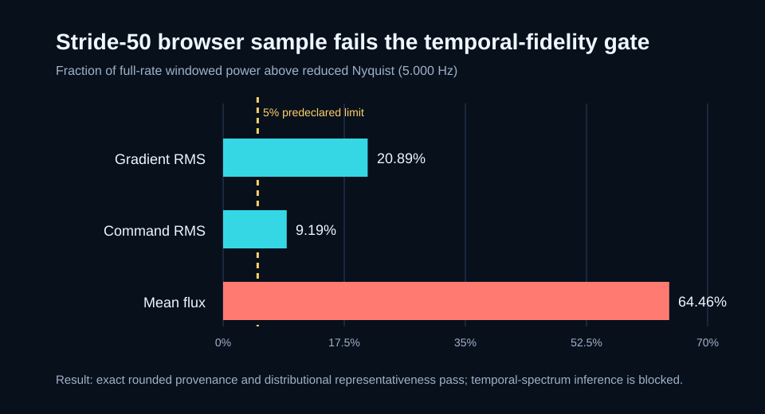

# Adaptive Optics Wavefront Lab
## A learning project in telemetry, feedback and scientific inference

**Biswajit Jana · Independent learning project · 22 October 2026**

## Abstract

This project connects my interest in instrumentation and feedback control with astronomical imaging. I use a public adaptive-optics telemetry release to learn how wavefront-sensor measurements and mirror commands are represented, processed and communicated. The main evaluated question is narrow: **what information survives the stride-50 reduction used by this browser display?**

The pipeline retains a CIAO1 AOT FITS observation, produces a lightweight browser representation, and tests provenance, three distributional summaries and a temporal-fidelity criterion separately. All 79,200 retained telemetry values reproduce the selected source values within the declared rounding bound. The three scalar diagnostics pass the repository's distribution thresholds, but all fail its temporal criterion. The result is a useful sparse overview, not a product for recovering closed-loop bandwidth or temporal spectra. A separate six-mode optical/control model supports learning; it is not fitted to CIAO.

## 1. Motivation and question

I started this project to connect instrumentation and feedback-control concepts to their role in astronomical imaging, and to learn wavefront sensing and adaptive optics through real telemetry rather than equations alone. My aim is to understand what a measurement means, how a computational representation changes it, and when a visually convincing output does not justify a physical conclusion.

AO systems use wavefront measurements and corrective optics in a feedback loop. The released measurements provide an entry point into that chain, but they are not automatically an image of the incoming wavefront. A calibrated reconstruction would require additional instrument knowledge.

My working question became: **does a 300-frame browser product preserve enough of a 15,000-frame observation for provenance checks, coarse distribution summaries and temporal interpretation?** Keeping those as separate questions is central to this project.

## 2. Contribution and ownership

The contribution represented by this repository is a reproducible data-inspection and validation workflow, an observation-first browser interface, and a deliberately separate teaching model. The audit and documentation make the limits of a reduced data product visible rather than treating a dashboard as scientific validation.

The observation was acquired and released by the source teams; I did not acquire the telescope data, build CIAO, calibrate its controller, or demonstrate an on-sky improvement. Source attribution belongs to Gomes and collaborators and the relevant ESO instrumentation teams. The repository is authored and maintained by Biswajit Jana. AI-assisted development and review were used in this upgrade; this report is not evidence that every line was written unaided. Understanding the equations, reproducing the tests and explaining the boundaries remain my responsibility.

## 3. Source and provenance

The input is `CIAO1_2019-12-06_DATA_EXPO-015808.fits`, from the [AOT proof-of-concept release](https://doi.org/10.5281/zenodo.8192742). The release description associates CIAO with ESO programme **60.A-9278(C)**. This attribution comes from the release description, not a programme keyword asserted to exist in this FITS header.

The filename contains 6 December, while the retained observation metadata starts at 01:58:09 UTC on 7 December 2019. File naming and observation timestamp are therefore reported separately.

| Property | Value |
| --- | --- |
| Source frames | 15,000 |
| Released loop-rate metadata | 499.962 Hz |
| Browser selection | Frames 0, 50, …, 14,950 |
| Retained frames | 300 |
| Effective reduced rate | 9.99924 Hz |
| Reduced Nyquist frequency | 4.99962 Hz |
| Gradient X / Y | 68 channels each |
| Subaperture intensity | 68 channels |
| HODM commands | 60 channels |
| Retained telemetry values | 300 × (68 + 68 + 68 + 60) = 79,200 |
| Additional coordinates | 300 timestamps and 300 frame indices |

The FITS MD5 is `069b37b24997bf55c5312a7bad469502`. SHA-256 receipts for both source and browser product are committed in the [machine-readable audit](research/generated/telemetry-decimation-audit.json). Verification reads the committed source; it does not silently replace the observation with a newer download.

## 4. Pipeline and definitions

**Released FITS → explicit stride selection → rounded JSON → independent audit → browser inspection.**

1. Read timestamps, gradient arrays, subaperture intensities and HODM positions from the AOT FITS extensions.
2. Select every 50th frame, retaining the source-frame index. Round JSON floating-point values to six decimal places for the browser product.
3. Independently reopen the source FITS and compare every selected value to the browser representation.
4. Compute full-rate and retained-sample diagnostics for distribution comparison.
5. Compute above-reduced-Nyquist power from the **full-rate** diagnostics, not from the already reduced series.
6. Display the retained matrices and audit findings. Keep the optional model on a separate path.

For frame k, the scalar diagnostics are:

- Gradient RMS: square root of the mean of squared X and Y gradients over both components and 68 channels.
- Command RMS: square root of the mean of squared HODM command values over 60 actuators.
- Mean flux: arithmetic mean of the 68 subaperture intensity values.

Gradient and command values remain in their released native units. Neither RMS is labelled as calibrated wavefront error in nanometres. Header `STREHL-R = 0.71` is a fixed released summary, not a per-frame reconstructed Strehl measurement.

## 5. Evaluation protocol

### Provenance gate

Each retained floating-point value must differ from the corresponding source value by no more than `5.01e-7`. This accommodates six-decimal rounding. Integer source-frame indices must match exactly. Shapes are checked before values.

### Distribution gate

For each of the three diagnostics, the retained mean must be within 0.10 full-rate standard deviations of the full-rate mean. Each of the 5th, 50th and 95th percentiles must be within 0.20 full-rate interquartile ranges of its full-rate counterpart. Standard deviation uses sample normalisation; quantiles use linear interpolation.

These are **repository acceptance thresholds**, not universal AO standards. “Predeclared” in the audit refers to thresholds in the code; it does not mean an externally registered research protocol. Passing these tests is not proof of equality of distributions or of fidelity for every channel.

### Temporal gate

Subtract the full-series mean, apply a Hann window, compute the real FFT, and square its magnitude. Divide the power above 4.99962 Hz by the total non-DC power. The acceptance limit is 5% for each diagnostic.

This tests the risk in uniform point decimation without anti-alias filtering. It is not a calibrated temporal transfer-function estimate, a frequency-resolved noise budget or a measurement of the actual alias error in every retained channel.

## 6. Results and interpretation

| Diagnostic | Mean error / full SD | Largest percentile error / full IQR | Power above reduced Nyquist |
| --- | ---: | ---: | ---: |
| Gradient RMS | 0.0054 | 0.1092 | 20.89% |
| Command RMS | 0.0272 | 0.0115 | 9.19% |
| Mean flux | 0.0411 | 0.0998 | 64.46% |



The provenance gate passes for 79,200 telemetry values, 300 timestamps and 300 source-frame indices. All three diagnostics pass the distribution gate. All three fail the temporal gate.

The defensible conclusion is that this exact rounded sample supports a sparse visual overview and the specified coarse summaries for this observation. It cannot support claims about loop bandwidth, disturbance rejection or temporal spectra from the browser product. **A failed reduction gate is not a failure of CIAO.** It is evidence about the representation chosen for this interface.

The study covers one roughly 30-second observation and three aggregate diagnostics. It does not establish generalisation across observing conditions, instruments or targets, nor does it evaluate channel cross-correlations, individual-channel spectra or uncertainty across independent observations.

## 7. The separate teaching model

The model uses six Noll-index Zernike modes: J4, J5, J6, J7, J8 and J11. The modes are unit-RMS on a continuous clear unit disk; a finite 128 × 128 pupil grid approximates that geometry. Mode coefficients are expressed in waves. Dynamic disturbances are deterministic sums of sinusoids, with seeded Gaussian measurement noise. This is not a Kolmogorov phase-screen simulation or a physical photon/read-noise model.

A delayed modal error drives a custom accumulating correction. With dt = 1 / model loop rate:

```text
I[k] = clamp(I[k-1] + e[k] dt, -2, 2)
delta[k] = Kp e[k] + Ki I[k] + Kd (e[k] - e[k-1]) / dt
u[k+1] = clamp(u[k] + clamp(delta[k], -0.25, 0.25), -3, 3)
residual = incoming - u
```

The proportional contribution itself accumulates in u. Consequently this is not a standard positional or velocity-form PID, and setting Ki to zero does not necessarily leave a static offset. Gains are teaching parameters, not measured CIAO gains.

The model reports modal RMS, the Maréchal approximation `exp[-(2πσ)^2]`, and a separately computed FFT intensity peak normalised by the ideal clear-pupil peak. Maréchal is a small-phase approximation, not a reliable universal predictor at large aberration. The displayed PSF uses logarithmic intensity normalised to its own frame maximum; image brightness alone cannot compare absolute peaks across frames.

The wavelength slider is explicitly a **conversion wavelength**: residual OPD in nm equals residual RMS in waves times wavelength in nm. It does not alter the fixed-wave phase model, predict chromatic behaviour or provide an angular plate scale.

Absent components include a calibrated WFS reconstructor, interaction matrix, measured mirror influence functions, obscurations, non-common-path aberrations and a measured control transfer function. Simulated outcomes must not be presented as recovered on-sky performance.

## 8. What this work demonstrates—and what I still need to learn

The repository provides inspectable evidence of three kinds of work:

| Learning area | Evidence in the project | Next competency to develop |
| --- | --- | --- |
| Scientific data handling | FITS ingestion, source receipts, shape checks, retained indices and parity tests | Instrument calibration and uncertainty propagation |
| Scientific reasoning | Separate provenance, distribution and temporal gates; documented negative result | Multi-observation evaluation and signal-processing design |
| Optics and feedback | Noll basis, pupil-phase FFT, bounded delayed modal feedback | Calibrated reconstruction and conventional AO control formulations |
| Research software | Worker-based UI, numerical tests, reproducible generated evidence and CI | Independent review and wider cross-platform testing |

These are concrete learning outputs, not a claim of expert mastery. The central learning outcomes are explaining the data lineage, reproducing the reported values, distinguishing measured quantities from model outputs and justifying the limitations.

## 9. Reproduction and demonstration

Use Node 24 and Python 3.12 with the pinned dependencies:

```bash
python -m pip install -r requirements.txt
npm ci --ignore-scripts
npm run check
python research/audit_telemetry.py
python tools/validate_observations.py
python tools/validate_model.py
python tools/build_reports.py
git diff --exit-code -- research/generated data/validation_summary.csv report.html summary.html
python -m http.server 8000
```

Open `http://localhost:8000/` for the overview and `/lab.html` for the lab. Serve over HTTP: opening the HTML as a local file is not the supported worker/fetch path.

Tests call the deployed science core and actual worker FFT. They check numerical invariants and selected controlled cases; passing tests is not validation of the model against CIAO physics. The CI workflow also regenerates scientific evidence and checks for drift.

To explore the project, start with the overview, trace a retained frame in the lab, and read the temporal-gate interpretation. Switching simulation on opens the independent teaching model, not a reconstruction of the observation.

## 10. Proposed next study

The next experiment is **not yet an achieved result**: compare stride sampling against an anti-aliased reduction of the full-rate telemetry.

Before running it, specify the target bandwidth, filter design and attenuation, time alignment, edge handling, and acceptance thresholds. Preserve the unfiltered reference and compare in-band spectra and time-domain errors. Test multiple observations if available, and report uncertainty and failure cases. Filtering the raw channels before nonlinear RMS aggregation is not equivalent to filtering an already aggregated diagnostic; the experiment must state which quantity it preserves.

A subsequent calibrated reconstruction would require establishing which calibration products are available. I should not claim a reconstructed residual phase or controller improvement until that chain is justified.

## References and attribution

1. Gomes et al. (2023), [Proof-of-concept AO telemetry data using the AOT standard format](https://doi.org/10.5281/zenodo.8192742). Source data: CC BY 4.0.
2. Gomes et al. (2024), [Adaptive optics telemetry standard: Design and specification of a novel data exchange format](https://doi.org/10.1051/0004-6361/202348486), A&A 686, A7.
3. Noll (1976), [Zernike polynomials and atmospheric turbulence](https://doi.org/10.1364/JOSA.66.000207), JOSA 66, 207–211.

See [methods](METHODS.md), the [claim ledger](CLAIMS.md), [citation metadata](CITATION.cff) and [software licence](LICENSE). The overview, report and project summary summarise the same committed evidence; they do not introduce a new observational result.
